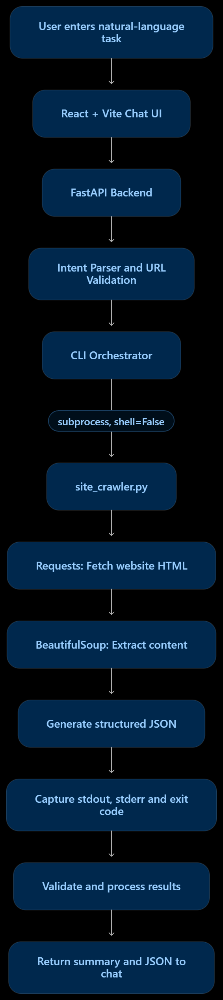
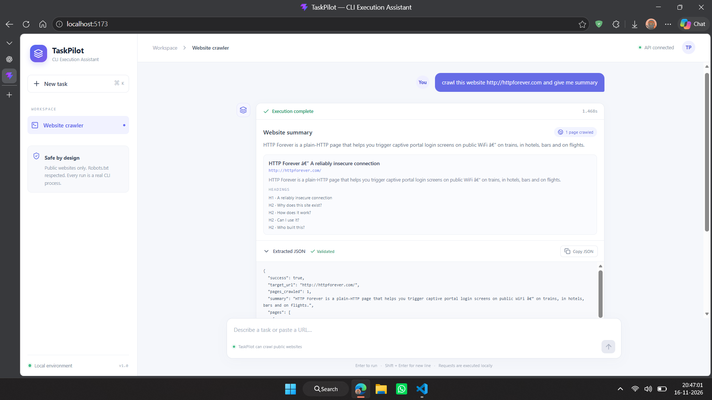
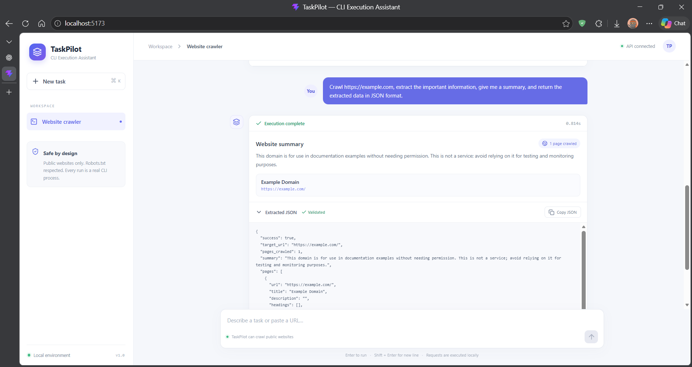
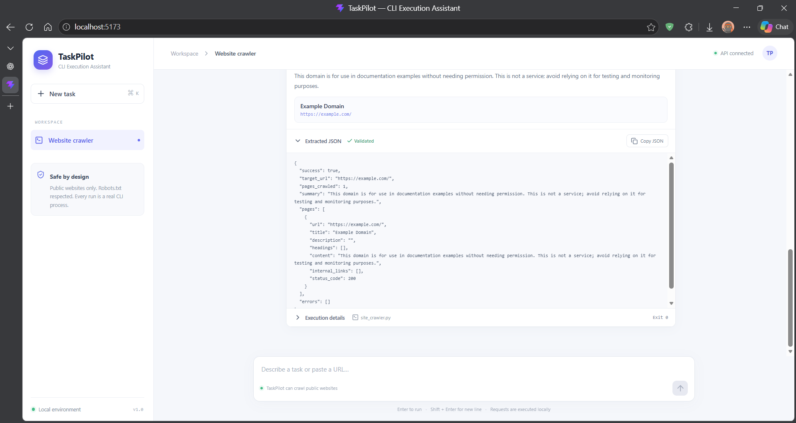

# TaskPilot — CLI Execution Assistant

TaskPilot turns a plain-language website request into a validated task, runs a separate Python crawler process, and returns extracted live website content and JSON in a chat interface. It addresses the gap between asking for a web task and seeing an auditable local tool actually execute it.

## Features

- React/Vite chat dashboard with example prompts, loading and failure states, readable results, JSON viewer, and copy button.
- Transparent, rule-based request parsing. No LLM, API key, account, or paid service is used at runtime.
- FastAPI orchestration launches only the bundled crawler with `subprocess.run([...], shell=False)`, captures stdout/stderr/exit code, and enforces a 45-second timeout.
- Requests and BeautifulSoup crawler checks robots.txt, limits work to five pages at depth one, captures titles, descriptions, headings, text, same-origin links, and HTTP status.
- URL resolution and redirect targets are checked to reject localhost and non-public IP addresses.

## Architecture



## Requirements and setup

- Python 3.10 or newer
- Node.js 20 or newer and npm
- Network access to the public site being crawled

From the repository root, install dependencies:

```powershell
python -m venv .venv
# Windows PowerShell
.\.venv\Scripts\Activate.ps1
python -m pip install -r backend/requirements.txt
npm install
```

Start the backend in one terminal:

```powershell
# from repository root
$env:PYTHONPATH = "backend"

export PYTHONPATH=backend   # if bash is used.
python -m uvicorn app.main:app --app-dir backend --host 127.0.0.1 --port 8000
```

Start the frontend in a second terminal:

```powershell
npm run dev
```

Open the Vite URL (normally http://localhost:5173). Vite proxies `/api` to `http://127.0.0.1:8000`. No environment variables are required; the `PYTHONPATH` command above is a local module-path setting for the backend terminal.

## Demo

Enter this exact prompt:

> Crawl https://example.com, extract the important information, give me a summary, and return the extracted data in JSON format.

The displayed pages and summary are extracted during that live run; they are not fixture data. The execution details panel shows the CLI name, exit code, duration, captured stdout/stderr, and backend-reported stages. Try `Summarize https://example.com` or `Extract JSON from https://example.com` as alternatives.

## CLI

```powershell
python backend/cli/site_crawler.py --url https://example.com --max-pages 5 --max-depth 1 --output-format summary_and_json
```

The CLI writes one JSON result to stdout and diagnostic messages to stderr. A disallowed robots rule or no crawlable HTML yields a non-zero exit code.

## Tests

```powershell
$env:PYTHONPATH = "backend"
python -m pytest backend/tests -q
```

## Security safeguards

- Only HTTP/HTTPS URLs are accepted; embedded credentials are rejected.
- Hostname IPs and every redirect destination are checked against non-public address ranges.
- Requests use timeouts, a 1.5 MB response cap, bounded redirects, same-origin links, five pages maximum, depth one maximum, and a descriptive User-Agent.
- robots.txt is consulted before pages are fetched. If robots rules cannot be safely obtained, the crawler fails closed; HTTP 404 means no published robots policy.
- User text is never placed in a command string. The backend invokes a fixed script and passes URL/limits as argument-list entries with shell disabled.
- Website text is treated as extracted data only; it is never interpreted as an instruction or command. Process environment is restricted to the minimum Python/Windows path variables.

## Known limitations

- Intent parsing is deliberately rule-based and English-oriented; it supports website crawling only.
- Redirect and DNS addresses are validated before each request, but the standard Requests resolver does not pin the validated DNS answer to the socket, so advanced DNS rebinding defenses would need a custom transport.
- The synchronous endpoint returns its event list after the crawl finishes. The UI shows a live waiting state while the process runs; it does not stream each backend event as it happens.
- The app does not render JavaScript-driven pages. It extracts HTML returned by the website and follows same-origin links only.
- This prototype is intended for local demonstration, not deployment as a public crawling service.

## AI tools

Codex was used as an AI coding assistant during development. The runtime intent parser is rule-based; no external AI model is called.

## Screenshots




